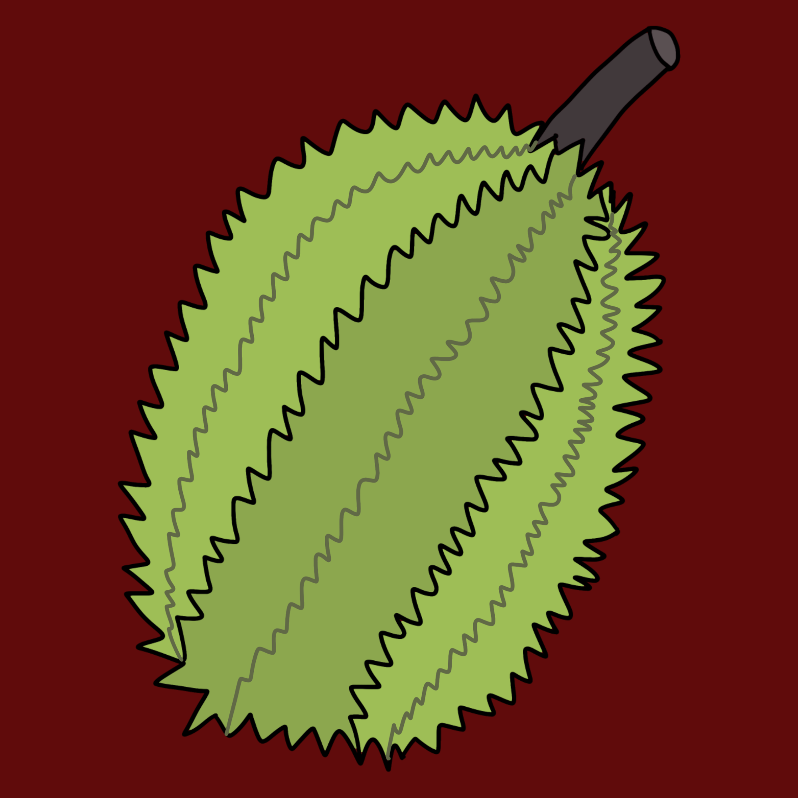

#JACKFRUIT

### Android Remote Access Trojan (RAT) — Under Development

<p align="center">
  
</p>

<p align="center">
  <strong>Open Source · Android Security · Remote Administration Research</strong>
</p>

<p align="center">
  
  
  
  
</p>

---

## 📖 About

**JACKFRUIT** is an open-source Android Remote Access Trojan (RAT) research project currently under development.

The project explores Android application architecture, remote device administration, client-server communication, authentication, permission management, and mobile security research.

JACKFRUIT is intended for cybersecurity education, controlled laboratory experiments, and authorized device administration.

The project prioritizes transparency, explicit user consent, and responsible security practices.

> ⚠️ **Development Notice:** JACKFRUIT is currently under development. The complete feature set is not yet available. This repository does not represent a production-ready application.

---

## ✨ Planned Features

| Feature | Description | Status |
|---|---|---|
| Device Registration | Register authorized Android clients | Planned |
| Device Information | Display basic device information | Planned |
| Remote Dashboard | Centralized web-based interface | Planned |
| Authentication | Secure user authentication | Planned |
| Permission Management | Transparent Android permission demonstrations | Planned |
| Location Demonstration | Consent-based location sharing | Planned |
| Network Communication | Secure client-server communication | Planned |
| Activity Logs | Transparent session and activity records | Planned |
| Session Management | Start and terminate authorized sessions | Planned |

All device access must be explicitly authorized by the device owner.

---

## 🏗️ Project Architecture

JACKFRUIT is planned around three primary components:

1. **Android Client:** Android application responsible for user consent, registration, and authorized operations.
2. **Backend Server:** Handles authentication, API requests, and session management.
3. **Web Dashboard:** Provides an interface for managing registered devices and authorized sessions.

```text
          ANDROID CLIENT
                |
                | HTTPS / TLS
                |
          BACKEND SERVER
                |
          Authentication
                |
          API MANAGEMENT
                |
          DATABASE
                |
          WEB DASHBOARD
```

---

## 📂 Repository Structure

```text
JACKFRUIT/
│
├── android/
│   └── app/
│
├── server/
│   ├── api/
│   ├── authentication/
│   └── requirements.txt
│
├── dashboard/
│   └── src/
│
├── assets/
│   ├── css/
│   │   └── style.css
│   └── JACKFRUIT.png
│
├── docs/
│   ├── architecture.md
│   ├── installation.md
│   └── security.md
│
├── screenshots/
│
├── index.html
├── .gitignore
├── LICENSE
└── README.md
```

---

## 🛠️ Technology Stack

### Currently used

| Technology | Purpose |
|---|---|
| HTML5 | Project website |
| CSS3 | Website styling |
| Git | Version control |
| GitHub | Source code hosting |
| Python | Development environment |

### Planned technologies

| Technology | Purpose |
|---|---|
| Kotlin | Android development |
| Android SDK | Android application framework |
| Python | Backend development |
| FastAPI | Backend API |
| React | Web dashboard |
| SQLite | Initial database |
| HTTPS / TLS | Encrypted communication |
| Token Authentication | Access control |
| Gradle | Android build management |

Technologies listed as planned are not necessarily implemented yet.

---

## 🚀 Getting Started

### 1. Requirements

- Linux, Windows, or macOS
- Git
- Python 3
- Android Studio
- Android SDK
- Java Development Kit
- Node.js (for dashboard development)

### 2. Clone the repository

```bash
git clone https://github.com/sangram-net/JACKFRUIT.git
```

### 3. Enter the project directory

```bash
cd JACKFRUIT
```

### 4. Explore the project

```bash
ls -la
```

### 5. Preview the project website

```bash
python3 -m http.server 8000
```

Open:

```text
http://localhost:8000
```

### 6. Development

Android, backend, and dashboard components will receive their individual installation instructions as development progresses.

Refer to the `docs/` directory for project documentation.

---

## 👤 Normal User Guide

The intended user workflow is:

1. Obtain the application from an official project release.
2. Read the application's purpose and privacy information.
3. Register the device through an explicit consent process.
4. Review the permissions requested by Android.
5. Grant only permissions you understand and agree to.
6. Connect to the authorized management dashboard.
7. Review available device information and active sessions.
8. Terminate the session or revoke access whenever desired.

No hidden installation, silent permission granting, or unauthorized device access is intended.

---

## 🔐 Security & Privacy

Security is a core consideration throughout development.

JACKFRUIT aims to implement:

- Explicit user consent.
- Secure authentication.
- Encrypted network communication.
- Permission transparency.
- Session termination controls.
- Access logging.
- Responsible data handling.
- No unauthorized persistence or covert surveillance.

Read [SECURITY.md](docs/security.md) for additional information.

---

## 🗺️ Development Roadmap

- [x] Create GitHub repository.
- [x] Establish project identity and branding.
- [x] Create initial directory structure.
- [x] Develop dark-themed project website.
- [x] Publish initial documentation.
- [ ] Establish Android development environment.
- [ ] Develop Android client interface.
- [ ] Implement consent-based registration.
- [ ] Develop backend authentication.
- [ ] Develop REST API.
- [ ] Build web dashboard.
- [ ] Implement secure session management.
- [ ] Conduct security testing.
- [ ] Publish initial research release.

---

## 📸 Screenshots

Project screenshots and demonstrations will be published in:

```text
screenshots/
```

---

## ⚖️ Responsible Use

JACKFRUIT is intended exclusively for:

- Cybersecurity education.
- Authorized security research.
- Personal Android device testing.
- Controlled laboratory environments.
- Transparent device administration.

**Never use this project to access, monitor, or control devices without the explicit authorization of their owners.**

Users are responsible for complying with applicable laws and regulations.

---

## 🤝 Contributing

Contributions are welcome.

You can contribute through:

1. Reporting bugs.
2. Improving documentation.
3. Suggesting security improvements.
4. Reviewing source code.
5. Submitting pull requests.

All contributions must follow the project's security and privacy principles.

---

## 📜 License

This project is distributed under the MIT License.

See [LICENSE](LICENSE) for details.

---

## 👨‍💻 Developer

**Sangram Ganguly**

- GitHub: https://github.com/sangram-net
- Repository: https://github.com/sangram-net/JACKFRUIT

---

<p align="center">
  <strong> JACKFRUIT</strong>
  <br>
  Open Source. Transparent. Security Research.
  <br><br>
  <code>UNDER DEVELOPMENT</code>
</p>
